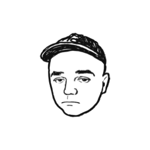
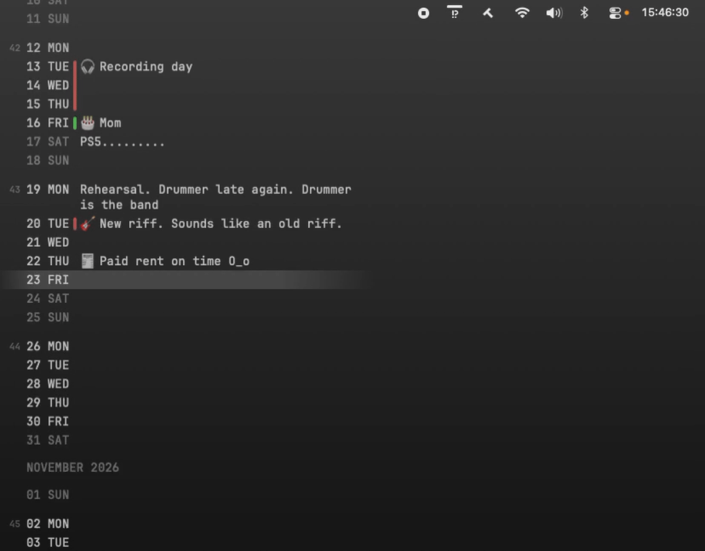
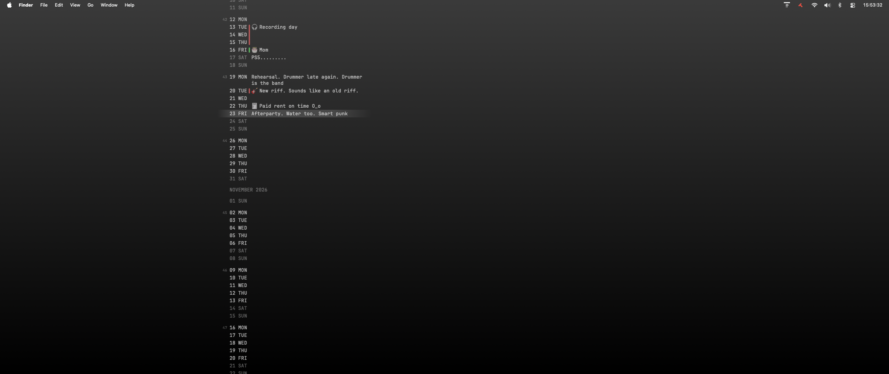

*Days fly by, and sometimes one question comes to mind: what was that?!*

<p align="center">
  
</p>

<h1 align="center">What Was That!?</h1>

<p align="center">
  <a href="https://github.com/lukyanetc/what-was-that/releases/latest">Download</a>
</p>

A quiet day-by-day timeline on your macOS desktop that doesn't get in the way of your work.
One entry per day, to remember or plan what matters.

*Inspired by the video [Linear Calendar in Apple Notes](https://www.youtube.com/watch?v=Et_QEhwwmec&t=11s) from the New Perspectives channel.*


<p align="left"></p>

## Features

- **Not a widget!** Clicks pass through the app until you press `opt+m`.
- **Customization.** Set everything to your taste — date format, size, font, opacity and more.
- **Feed, Range, Month or Week.** Everyone sees time in their own way.
- **A color for every day.** Mood, vacation, weather — come up with your own meaning. Consecutive days of the same color merge into a stripe.
- **Calendar.** If you need it, turn on your Mac's calendars.
- **If one line isn't enough,** press `shift+enter` and keep writing.
- **If you really run out of room,** press `↗` and create a note in Obsidian or Apple Notes.
- **No accounts, no servers.** Everything is stored in plain JSON in your Documents folder. Export all your entries anytime.

## Screenshot


<p align="center"></p>


  ```json
  {
    "2026-03-10": { "text": "🚧 Started the bathroom renovation", "color": 2 },
    "2026-03-12": { "text": "⚠️ Plumber" }
  }
  ```

- You can put the file in iCloud Drive to sync between Macs.

## Install

Requires macOS 15 Sequoia or later. Download the `.dmg` from the [latest release](https://github.com/lukyanetc/what-was-that/releases/latest).

The app isn't signed by Apple, so you need to allow the first launch manually: **System Settings → Privacy & Security → Open Anyway**. Step-by-step instructions are inside the `.dmg`.

## Build from source

You'll need macOS 15+ and Xcode. Open `d-cal.xcodeproj`, select the `MyApp` scheme and run. App Sandbox is off: the app needs access to its data file in any folder, including iCloud Drive.

`scripts/build-release.sh` makes a release build: a universal app (Intel and Apple Silicon) without signing, output as `.app`, `.zip` and `.dmg` in `dist/`.

Tests: the `MyAppTests` target (Swift Testing). Build `MyApp` before running them.

## Thanks

`[100% vibe coding]`

Thanks to the [New Perspectives](https://www.youtube.com/watch?v=Et_QEhwwmec&t=11s) channel for the idea of a linear calendar.<br>
Thanks to these times, when even I could make my own app.<br>
Claude Code — ❤️

The bundled fonts JetBrains Mono, IBM Plex Mono, Fira Code and Geist Mono are distributed under the SIL Open Font License; license texts are in `MyApp/Fonts`.
